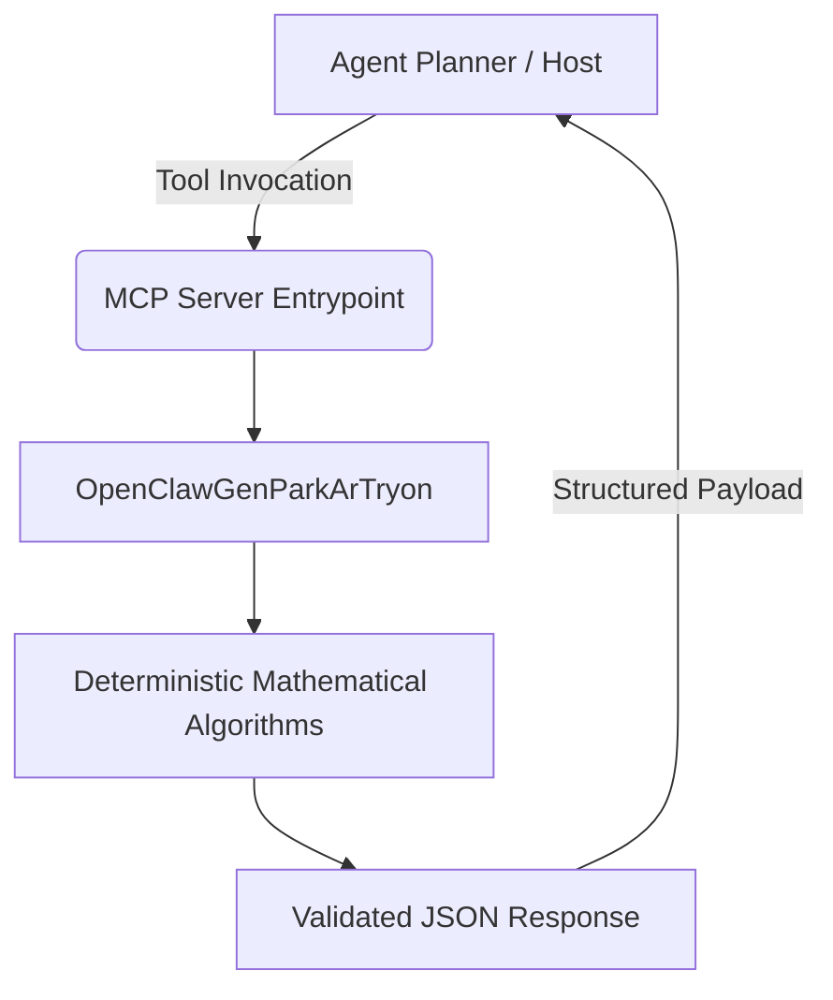

# openclaw-genpark-ar-tryon

[](https://github.com/Alpha-Park/openclaw-genpark-ar-tryon)
[](requirements.txt)
[](https://modelcontextprotocol.io/)
[](https://opensource.org/licenses/MIT)
[](https://github.com/Alpha-Park/openclaw-genpark-ar-tryon)

Production-grade agentic micro-skill designed for the OpenClaw and GenPark swarms. The core client uses Python's standard library; the MCP server uses the official MCP SDK.

## Architecture & Flow



## Features

- **Core Client**: Uses Python's standard library. The MCP server additionally requires the official MCP SDK.
- **Model Context Protocol (MCP)**: Native FastMCP JSON-RPC interface for seamless tool-calling in Claude, Cursor, and OpenClaw.
- **Algorithmic Rigor**: Rigorous closed-form mathematical equations and quantitative deterministic metrics.
- **Source Repository**: [Alpha-Park/openclaw-genpark-ar-tryon](https://github.com/Alpha-Park/openclaw-genpark-ar-tryon).

## Installation & Usage

```bash
git clone https://github.com/Alpha-Park/openclaw-genpark-ar-tryon.git
cd openclaw-genpark-ar-tryon
python example_usage.py
```

## MCP Runtime Requirements

Use Python 3.10+ for the MCP server. The core `client.py` has no external dependencies; MCP transport requires `mcp>=1.0.0,<2`. From this checkout, install it into the Python environment used by your MCP client:

```bash
python -m pip install -r requirements.txt
```

Use the same Python interpreter to launch `mcp_server.py`. In desktop client configuration, set `command` to that interpreter's absolute path.

## MCP Configuration

Add to your `claude_desktop_config.json`:
```json
{
  "mcpServers": {
    "openclaw-genpark-ar-tryon": {
      "command": "/absolute/path/to/python",
      "args": ["/absolute/path/to/openclaw-genpark-ar-tryon/mcp_server.py"]
    }
  }
}
```

Set `args` to the absolute path to this checkout's `mcp_server.py`, and `command` to the Python interpreter where the requirements were installed. The client uses a local STDIO connection.

## License

MIT License. See [LICENSE](LICENSE) for details.
